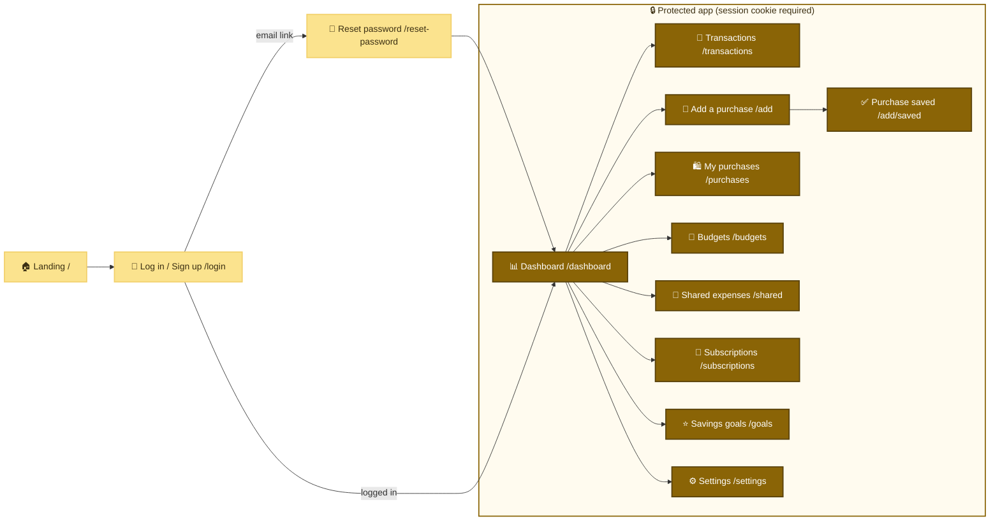
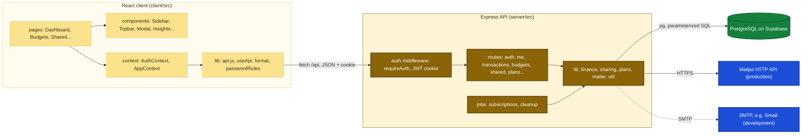
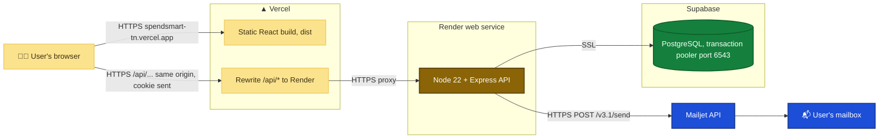
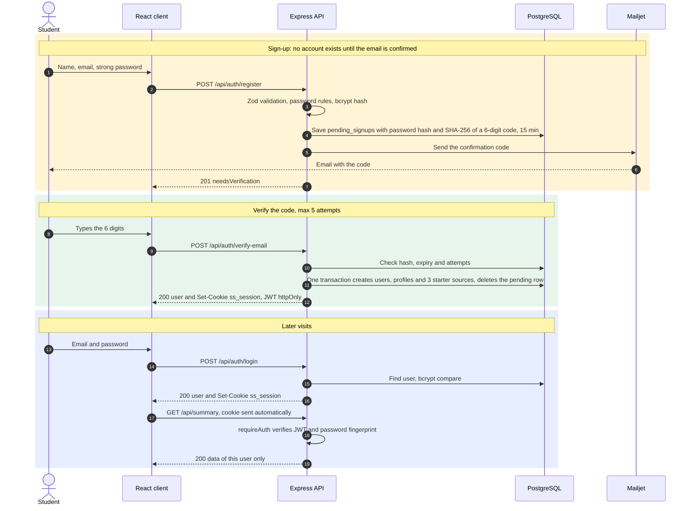
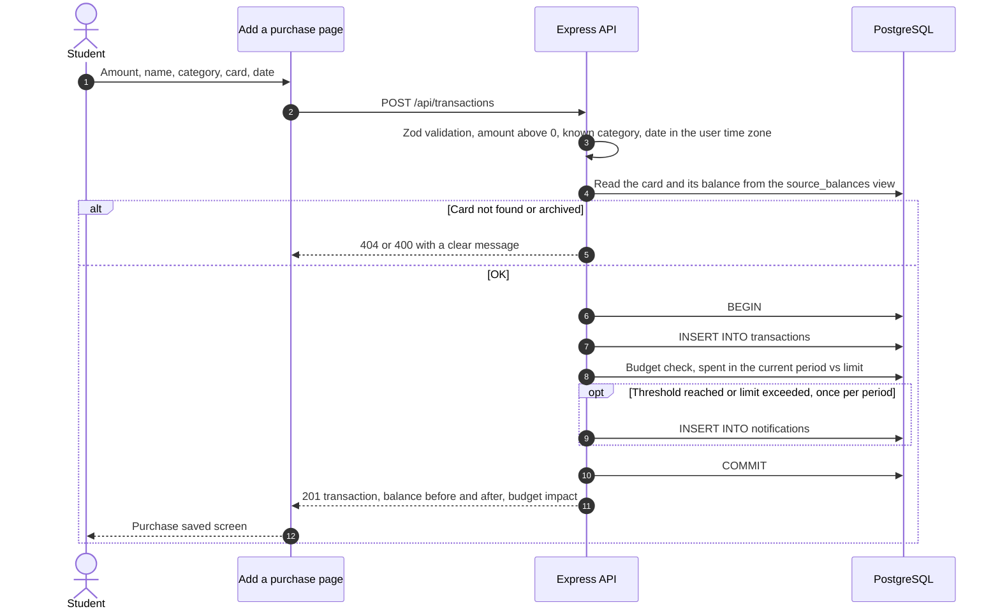
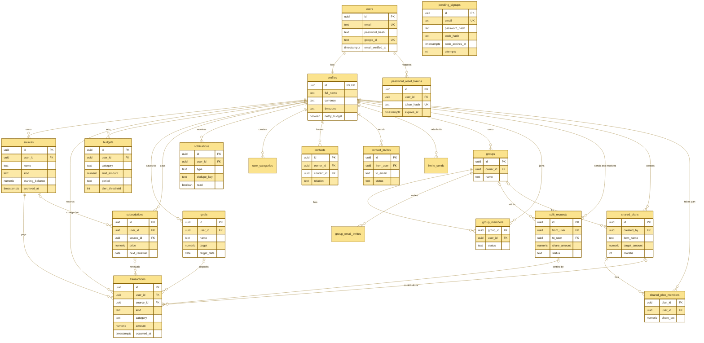
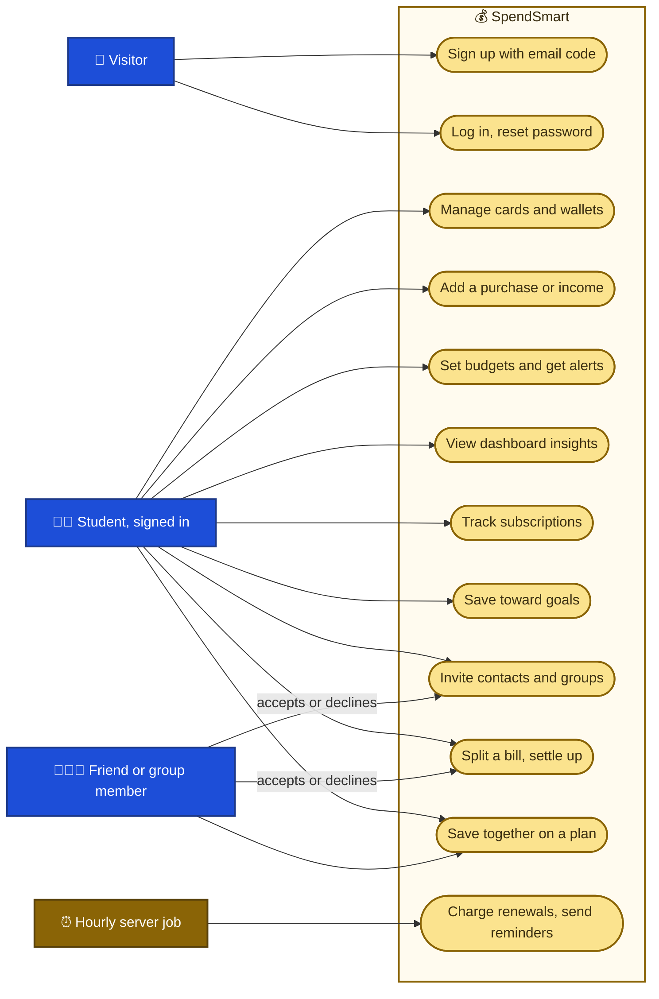

<a id="top"></a>

<div align="center">

# 💰 SpendSmart

### Know where every coin goes

*✍️ Spend smart, live happy!*

<br>

<a href="https://spendsmart-tn.vercel.app"></a>

**🌐 [https://spendsmart-tn.vercel.app](https://spendsmart-tn.vercel.app)**

<br>


<br>


<br>

**Group 13** · Maram Kouki · Imen Khedimallah · Emna Borchani<br>
Supervisor: **Dr. Maroua Nouioua** · **SUP'COM** · Projet Web 2026/2027

</div>

<br>

> [!WARNING]
> **Check your Spam folder!** The confirmation code email may land in your **Spam / Junk** folder (Gmail: also check the **Promotions** tab). Mark it as **"Not spam"** so the next ones arrive in the inbox.

> [!NOTE]
> The API runs on **Render's free plan** and sleeps after **15 minutes** without visits: the first request can take **30–50 seconds** while it wakes up. After that, everything is fast.

---

## 📑 Table of contents

| | | |
| --- | --- | --- |
| 1. [✨ About](#-about) | 6. [🔐 Security](#-security) | 11. [🔌 API overview](#-api-overview) |
| 2. [🎯 Features](#-features) | 7. [⚡ Performance](#-performance) | 12. [🎨 Design](#-design) |
| 3. [🗺️ Sitemap](#️-sitemap) | 8. [🚀 Deployment](#-deployment) | 13. [📸 Screenshots](#-screenshots) |
| 4. [🏗️ Architecture (UML)](#️-architecture-uml) | 9. [💻 Run it locally](#-run-it-locally) | 14. [👥 Team](#-team) |
| 5. [🧰 Tech stack](#-tech-stack) | 10. [📁 Project structure](#-project-structure) | |

---

## ✨ About

**SpendSmart** is a personal finance web app built for **students**.

Student money is spread everywhere: a debit card, some cash, a credit card, a subscription you forgot about, and the pizza you paid for your flatmates. At the end of the month nobody knows where it all went.

SpendSmart puts everything in one place:

- 💳 every **card and wallet** with its live balance;
- 🧾 every **purchase and income**, in seconds;
- 🎯 **budgets** that warn you *before* you overspend;
- 🤝 **shared expenses** with friends, flatmates or a group, only after they accept;
- 🔁 **subscriptions** that renew automatically, with a reminder;
- 🐷 **savings goals**, alone or together.

> [!TIP]
> After signing up, click **"Load sample month"** on the dashboard to fill your account with demo data and explore every screen.

<div align="right"><a href="#top">⬆️ Back to top</a></div>

---

## 🎯 Features

<table>
<tr>
<td valign="top" width="50%">

#### 💳 Cards & wallets
- Debit, credit, cash or other, with an optional last 4 digits and a card style
- Live balance = starting balance + income − spending (computed, never stored)
- Archive a card and restore it later; history is kept

#### 🧾 Transactions
- Everything that came in and went out, filtered and grouped
- Add **income** in a modal; delete a transaction

#### 🛒 Add a purchase → Purchase saved
- Amount, name, category (Food, Coffee, Groceries, Transport, Bills…), card and date
- A summary screen shows the new balance and the budget impact

#### 🛍️ My purchases
- All your purchases with search and filters

#### 🎯 Budgets with periods and alerts
- A limit per category for a **week, month, quarter, year** or **custom** dates
- Spending counted in **your time zone**
- Alert at a chosen threshold (50–100 %) and when you go over, once per period

#### 📊 Dashboard insights
- *Where your money went*, a donut chart of this month by category
- *Daily spending* over the last 30 days
- *Money in vs out* over the last 6 months
- Upcoming renewals and goals at a glance

</td>
<td valign="top" width="50%">

#### 🤝 Shared expenses
- Add contacts **by email**: they must **accept the invitation** first
- Create **groups**, invite members, leave or remove them
- **Split** a bill: each person accepts or declines their share
- **Settle up** pending requests from a chosen card

#### 🐷 Saving together
- Shared plans to buy something together over 1–60 months
- Split equally or by percentage, and track everyone's progress

#### 🔁 Subscriptions
- Price, renewal date and card; charged **automatically** when due
- A reminder **3 days** before each renewal

#### ⭐ Savings goals
- Target amount and optional date, with progress
- Add money from a card in two taps (20 / 50 / 100 or your own amount)

#### 🔔 Notifications
- Budget alerts, split requests, invitations and renewals in the top-bar bell

#### ⚙️ Settings
- Profile, currency (**TND**, EUR, USD), notification preferences, cards & wallets, log out

#### 🔐 Auth
- Sign-up confirmed with a **6-digit email code**
- **Strong password** rules with a live checklist
- "Remember me", password reset by email, optional Google sign-in

</td>
</tr>
</table>

<div align="right"><a href="#top">⬆️ Back to top</a></div>

---

## 🗺️ Sitemap



<sub>🟨 Public pages · 🟫 App pages (signed in). Unknown routes redirect to the landing page.</sub>

---

## 🏗️ Architecture (UML)

<sub>Colour key: 🟨 **frontend** · 🟫 **backend** · 🟩 **database** · 🟦 **external services**</sub>

### a) Component diagram



### b) Deployment diagram



> [!IMPORTANT]
> **The same-origin cookie trick.** The browser only ever talks to the **Vercel** domain. Vercel forwards `/api/*` to Render, so for the browser the API is *same-origin*. The session cookie is then a normal first-party cookie (`httpOnly`, `Secure`, `SameSite=Lax`) and is not blocked as a third-party cookie. No CORS is needed in the browser.

### c) Sequence: sign-up and log-in



### d) Sequence: adding a purchase



### e) Entity–relationship diagram



<sub>Balances come from the <code>source_balances</code> view: starting balance + income − everything else. Also in the schema: <code>group_email_invites</code>, <code>invite_sends</code>, <code>user_categories</code>, and the legacy <code>shared_budgets</code> / <code>shared_budget_limits</code> (migrated to <code>shared_plans</code>). All 8 migrations are in <a href="supabase/migrations"><code>supabase/migrations/</code></a>.</sub>

### f) Use cases



<div align="right"><a href="#top">⬆️ Back to top</a></div>

---

## 🧰 Tech stack

| Layer | Technology | Why |
| --- | --- | --- |
| 🎨 UI | **React 18** | Components and hooks, a huge ecosystem |
| ⚡ Build | **Vite 6** | Instant dev server, fast builds with code splitting |
| 🧭 Routing | **React Router 6** | Client-side routes, protected app layout |
| 📊 Charts | **Recharts 2** | Declarative SVG charts for the dashboard insights |
| 🟢 Runtime | **Node.js 22** | Same language front and back; built-in `fetch` and `--env-file` |
| 🚂 API | **Express 4** | Small and well known; routers, middleware |
| ✅ Validation | **Zod** | One schema per request body, readable errors |
| 🗄️ Database | **PostgreSQL** (on **Supabase**) | Relations, transactions, constraints and views for money data |
| 🔌 DB driver | **pg** | Plain parameterized SQL, connection pool |
| 🔑 Auth | **bcryptjs** + **jsonwebtoken** | Password hashing and a signed session cookie |
| 🚦 Protection | **express-rate-limit**, **compression**, **cors** | Brute-force limits, gzip, origin allow-list |
| ✉️ Email | **Mailjet** HTTP API (prod), **nodemailer** SMTP (dev) | HTTPS works where SMTP ports are blocked |
| ☁️ Hosting | **Vercel** + **Render** | Free tiers, auto-deploy from GitHub |
| 🧹 Quality | **ESLint 9** + **Prettier 3** | Same rules and style for client and server |

> [!NOTE]
> **Why Supabase only as PostgreSQL?** We use Supabase only as a **hosted PostgreSQL database**. Authentication, business logic and emails are **our own Node.js API**: accounts live in our `users` table, passwords are hashed by us, sessions are our JWT cookies. We don't use Supabase Auth, the Data API or Edge Functions. This way we wrote and understand every part of the security, and the app could move to any PostgreSQL server.

---

## 🔐 Security

| | Measure | Detail |
| --- | --- | --- |
| 🔑 | **Password hashing** | **bcrypt**, cost 12. Unknown emails are compared against a dummy hash, so timing doesn't reveal which accounts exist |
| 💪 | **Strong passwords** | 8–72 characters, upper and lower case, a number, a symbol, not your name or email, not a common password. One shared rule file for the client checklist and the server |
| 🍪 | **Session cookie** | JWT (HS256) in an **httpOnly**, `SameSite=Lax`, `Secure` cookie that JavaScript can't read. It contains a password fingerprint, so a password reset signs out other sessions |
| 🔢 | **Email codes** | 6 digits from a cryptographic RNG, stored **only as a SHA-256 hash**, valid **15 min**, **5 attempts** max, resend once per minute |
| 🔗 | **Password reset** | Random token stored hashed, valid **1 hour**, single use |
| 🚦 | **Rate limiting** | Per IP on login, register, verify, resend, forgot and reset password (e.g. 10 failed logins / 15 min), using the real client IP behind the proxy |
| 🧱 | **SQL injection** | Every query is **parameterized** (`$1, $2…`), never built from user strings |
| 👤 | **Per-user data** | Every query is filtered by the signed-in user's id; another user's id returns 404 |
| 🗄️ | **Row Level Security** | **RLS on with no policies** on every table, so Supabase's public Data API can read nothing. Only our API (as table owner) reaches the data |
| 🤝 | **Consent before sharing** | Nobody becomes your contact, joins your group or sees your spending without **accepting an invitation** |
| 🌐 | **Cross-site requests** | CORS allow-list (`CLIENT_ORIGIN`) plus an `Origin` check on every state-changing request |
| 🔒 | **Secrets** | Only in **environment variables** (Render / local `.env`, git-ignored), never in the code or the repository |

<div align="right"><a href="#top">⬆️ Back to top</a></div>

---

## ⚡ Performance

Measured with `npm run build` and **Lighthouse 13** on the production build. Details and reports are in [`docs/performance.md`](docs/performance.md) and [`docs/lighthouse/`](docs/lighthouse).

| Metric | Before | After | |
| --- | ---: | ---: | :---: |
| JavaScript on first visit (gzip) | 221 kB | **77 kB** | 🟢 −65 % |
| Total page weight | 925 KiB | **175 KiB** | 🟢 −81 % |
| Login page, mobile performance score | 76 | **95** | 🟢 +19 |
| Login page, mobile LCP | 6.8 s | **3.0 s** | 🟢 −56 % |
| Accessibility · Best practices · SEO | 98 · 96 · 91 | **100 · 100 · 100** | 🟢 |

**What we did**

- 🧩 **Lazy loading:** every app page is loaded with `React.lazy` when first opened; the sidebar stays visible with a skeleton meanwhile.
- 📦 **Vendor chunks:** `react-vendor` (cached across deploys) and `charts` (Recharts, loaded only with the dashboard); the dashboard is preloaded right after log-in.
- 🗜️ **Compression:** gzip on the API responses.
- 🗃️ **Caching:** hashed `/assets/*` cached for a year (`immutable`); `index.html` always revalidated (`no-cache`).
- 🔤 **Fonts:** only the weights in use, loaded without blocking the first paint.
- ♿ **Accessibility:** `<main>` landmarks, labels, contrast fixes, `robots.txt` and meta tags.
- 🧹 **Code quality:** ESLint (React, Hooks, jsx-a11y) with **0 errors**, Prettier formatting, hook dependencies fixed properly.

---

## 🚀 Deployment

| Part | Platform | What runs there |
| --- | --- | --- |
| 🎨 Frontend | **Vercel** | Static React build from `client/`, plus the `/api/*` rewrite |
| 🚂 API | **Render** (free web service) | `npm run start -w server`, Node 22, health check `GET /api/health` |
| 🗄️ Database | **Supabase** | PostgreSQL, Transaction pooler (port 6543), SSL |
| ✉️ Email | **Mailjet** | HTTP API, because Render's free plan blocks SMTP ports |

**The rewrite** ([`client/vercel.json`](client/vercel.json)): `/api/*` goes to Render, everything else to the SPA.

```json
"rewrites": [
  { "source": "/api/:path*", "destination": "https://<render-service>.onrender.com/api/:path*" },
  { "source": "/(.*)", "destination": "/index.html" }
]
```

**Environment variables** (names only, values live in each platform's dashboard):

| Variable | Platform | Purpose |
| --- | --- | --- |
| `NODE_ENV`, `NODE_VERSION` | Render | `production` and `22` (set in [`render.yaml`](render.yaml)) |
| `DATABASE_URL` | Render | Supabase Transaction pooler connection string |
| `JWT_SECRET` | Render | Signs the session cookies |
| `CLIENT_ORIGIN` | Render | The Vercel URL, the only origin CORS allows |
| `APP_URL` | Render | The Vercel URL, used in password-reset links |
| `MAILJET_API_KEY`, `MAILJET_SECRET_KEY` | Render | Mailjet API keys |
| `SMTP_FROM` | Render | Sender name and address (validated in Mailjet) |
| `GOOGLE_CLIENT_ID` | Render | *Optional*: Google sign-in |
| `TRUST_PROXY`, `LOG_CLIENT_IP` | Render | *Optional*: proxy hops for the client IP, and a debug log |
| `BREVO_API_KEY`, `SMTP_HOST`, `SMTP_PORT`, `SMTP_USER`, `SMTP_PASS` | Render / local | *Optional*: other email transports (Brevo API, or SMTP for local development) |
| `VITE_API_URL` | Vercel | Leave **empty**: the client calls relative `/api` URLs |

> [!TIP]
> **Redeploying is just `git push`.** A push to `main` auto-deploys **both** Vercel (frontend) and Render (API).
> Database migrations are **not** run on deploy. Run `npm run db:migrate -w server` by hand when a new file appears in `supabase/migrations/`.

<div align="right"><a href="#top">⬆️ Back to top</a></div>

---

## 💻 Run it locally

**Prerequisites**

- **Node.js 22.9+** (the scripts use `--env-file-if-exists`)
- A **Supabase project** (free tier), or any PostgreSQL 15+ server

**1. Environment variables:** copy the examples and fill them in. The files explain every variable.

```bash
cp server/.env.example server/.env
cp client/.env.example client/.env
```

| File | Variables |
| --- | --- |
| `server/.env` | `DATABASE_URL`, `JWT_SECRET`, `PORT`, `CLIENT_ORIGIN`, `APP_URL`, optional `GOOGLE_CLIENT_ID`, email: `SMTP_HOST`, `SMTP_PORT`, `SMTP_USER`, `SMTP_PASS`, `SMTP_FROM` (or `MAILJET_API_KEY` + `MAILJET_SECRET_KEY`) |
| `client/.env` | `VITE_API_URL` (leave empty: Vite proxies `/api` to port 4000) |

> [!TIP]
> No email service set up locally? Leave the email variables empty: the **confirmation code is printed in the server console**.

**2. Install, migrate, run**

```bash
npm install
npm run db:migrate -w server
npm run dev
```

Then open **http://localhost:5173** 🎉

**3. Check the code**

```bash
npm run lint             # ESLint, client + server
npm run smoke -w server  # end-to-end smoke test against a real database
npm run build            # production build of the client
```

> [!CAUTION]
> `.env` files hold secrets and are **git-ignored**. Never commit them.

---

## 📁 Project structure

```text
spendsmart/
├── client/                    🎨 React app (Vite)
│   ├── public/                   favicon, robots.txt
│   ├── src/
│   │   ├── pages/                one file per screen (+ lazy.js for code splitting)
│   │   ├── components/           Sidebar, Topbar, Modal & UI kit, Insights charts, cards
│   │   ├── context/              AuthContext (session) and AppContext (data, toasts)
│   │   ├── lib/                  api client, useApi hook, formatting, password rules, icons
│   │   └── styles/               app.css + motion.css (animations)
│   ├── vercel.json               Vercel build, /api rewrite, cache headers
│   └── vite.config.js            dev proxy and vendor chunks
├── server/                    🚂 Express API
│   ├── src/
│   │   ├── index.js              app setup, security middleware, error handler
│   │   ├── auth.js               JWT cookie session, requireAuth
│   │   ├── db.js                 pg pool, transactions, timeouts
│   │   ├── routes/               auth, me, transactions, budgets, goals, subscriptions, shared, plans…
│   │   ├── lib/                  finance, sharing, plans, mailer, password rules, cleanup
│   │   └── jobs/                 subscription renewals and reminders
│   └── scripts/                  migrate, smoke test, email test, cleanup
├── supabase/migrations/       🗄️ SQL migrations (schema, RLS, constraints, views)
├── docs/                      📚 performance report, Lighthouse reports, backend audit
├── scripts/                      Lighthouse helpers
├── render.yaml                ☁️ Render Blueprint for the API
├── eslint.config.js              ESLint flat config (+ .prettierrc)
└── package.json                  npm workspaces and root scripts
```

<div align="right"><a href="#top">⬆️ Back to top</a></div>

---

## 🔌 API overview

All routes are under `/api` and use JSON. 🔒 = needs the session cookie.

| Area | Endpoints |
| --- | --- |
| 🔑 **Auth** | `POST /auth/register` · `POST /auth/verify-email` · `POST /auth/resend-code` · `POST /auth/login` · `POST /auth/logout` · `POST /auth/forgot-password` · `POST /auth/reset-password` · `POST /auth/google` · `GET /auth/session` · `GET /auth/me` · `GET /auth/config` |
| ❤️ Health | `GET /health` (no database access) |
| 👤 Profile 🔒 | `GET /me` · `PATCH /me` |
| 💳 Sources 🔒 | `GET /sources` · `POST /sources` · `PATCH /sources/:id` · `DELETE /sources/:id` (archive) · `POST /sources/:id/restore` |
| 📊 Summary 🔒 | `GET /summary` · `GET /analytics` · `POST /demo/seed` |
| 🧾 Transactions 🔒 | `GET /transactions` · `POST /transactions` · `DELETE /transactions/:id` |
| 🎯 Budgets 🔒 | `GET /budgets` · `POST /budgets` · `PATCH /budgets/:id` · `DELETE /budgets/:id` |
| ⭐ Goals 🔒 | `GET /goals` · `POST /goals` · `PATCH /goals/:id` · `DELETE /goals/:id` · `POST /goals/:id/contribute` |
| 🔁 Subscriptions 🔒 | `GET /subscriptions` · `POST /subscriptions` · `PATCH /subscriptions/:id` · `DELETE /subscriptions/:id` |
| 🤝 Sharing 🔒 | `GET /shared` · `POST /contacts` · `DELETE /contacts/:id` · `GET /invites` · `POST /invites/:id/accept` · `POST /invites/:id/decline` · `POST /groups` · `POST /groups/:id/invite` · `POST /groups/:id/accept` · `POST /groups/:id/leave` · `POST /splits` · `POST /splits/:id/accept` · `POST /splits/:id/decline` · `POST /settle` |
| 🐷 Saving together 🔒 | `GET /shared-plans` · `POST /shared-plans` · `PATCH /shared-plans/:id` · `POST /shared-plans/:id/contribute` · `DELETE /shared-plans/:id` · `GET /categories` · `POST /categories` |
| 🔔 Notifications 🔒 | `GET /notifications` · `POST /notifications/:id/read` · `POST /notifications/read-all` |

---

## 🎨 Design

A warm **cream and gold** theme that is friendly, calm and easy to read.


| | |
| --- | --- |
| 🔤 **Fonts** | **Poppins** (400–700) for the interface · **Caveat** (700) for the handwritten taglines like *"Every coin counts!"* |
| 📱 **Responsive** | Sidebar on desktop, a **bottom tab bar** on phones; modals become bottom sheets |
| 🪄 **Animations** | Spinning coins, scroll reveals and soft transitions, all turned off with `prefers-reduced-motion` |
| ♿ **Accessible** | Keyboard focus trap in modals, `Esc` to close, ARIA labels, Lighthouse accessibility **100** |

---

## 📸 Screenshots

<!--
  TODO: add screenshots of the live app here.
  Put the images in docs/screenshots/ with these names (PNG, ~1280 px wide):
    docs/screenshots/landing.png
    docs/screenshots/dashboard.png
    docs/screenshots/add-purchase.png
    docs/screenshots/budgets.png
    docs/screenshots/shared.png
    docs/screenshots/mobile.png
  Then replace this comment with the table below (remove the HTML comment markers around it):

<table>
  <tr>
    <td align="center"><br><b>🏠 Landing</b></td>
    <td align="center"><br><b>📊 Dashboard</b></td>
  </tr>
  <tr>
    <td align="center"><br><b>🛒 Add a purchase</b></td>
    <td align="center"><br><b>🎯 Budgets</b></td>
  </tr>
  <tr>
    <td align="center"><br><b>🤝 Shared expenses</b></td>
    <td align="center"><br><b>📱 Mobile</b></td>
  </tr>
</table>
-->

> [!NOTE]
> Screenshots are coming soon. In the meantime, try the **[live demo](https://spendsmart-tn.vercel.app)** 🚀

---

## 👥 Team

<div align="center">

| | Member | Role |
| :---: | --- | --- |
| 👩‍💻 | **Maram Kouki** | [role] |
| 👩‍💻 | **Imen Khedimallah** | [role] |
| 👩‍💻 | **Emna Borchani** | [role] |

**Supervisor:** Dr. Maroua Nouioua<br>
**SUP'COM** · Projet Web 2026/2027 · Group 13

<br>

*Made with 💛 and a lot of coffee ☕. Spend smart, live happy!*

<a href="#top">⬆️ Back to top</a>

</div>
