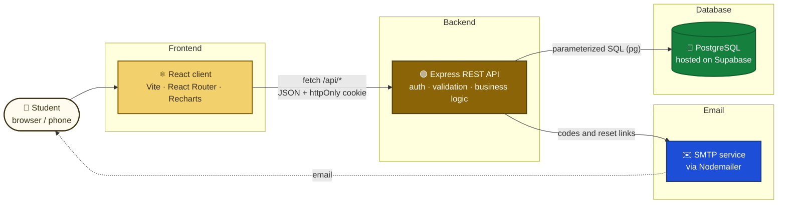
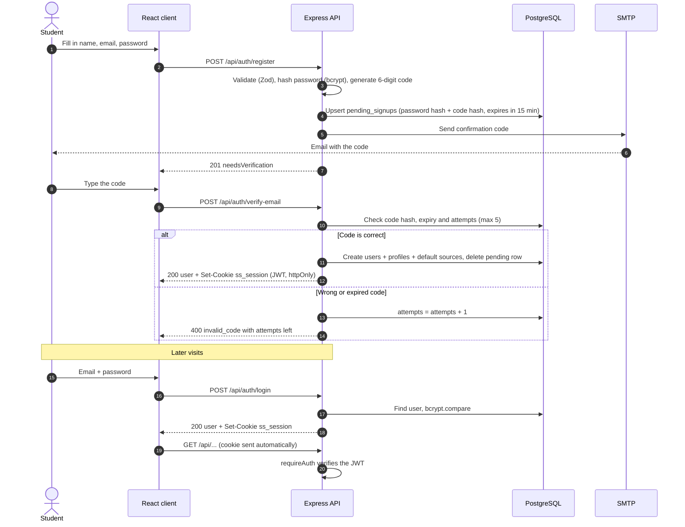
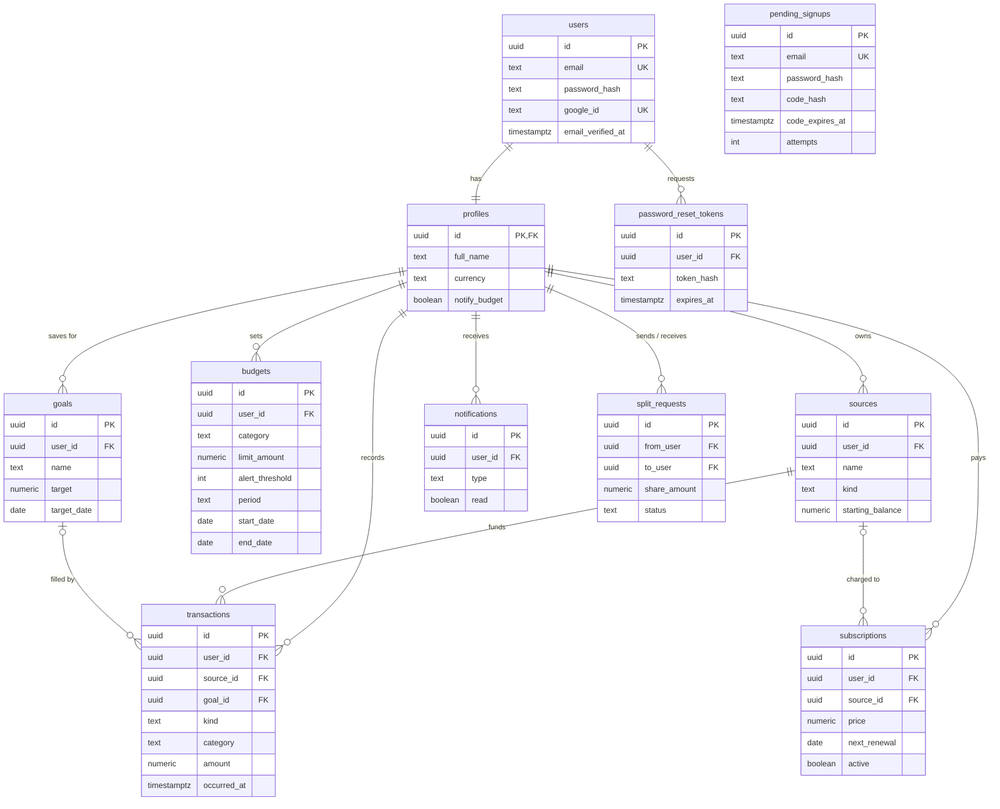

<div align="center">

# 🪙 SpendSmart

### *Know where every coin goes.*

A personal finance web app for students: cards and cash in one place, budgets that warn you in time, bills shared with roommates, subscriptions under control and savings goals that fill up.

<br>


<br>

**Students:** Maram Kouki · Emna Borchani · Imen Khedimallah

</div>

---

## 📑 Table of contents

1. [About the project](#-about-the-project)
2. [Tech stack](#️-tech-stack)
3. [Architecture](#️-architecture)
4. [Authentication flow](#-authentication-flow)
5. [Database](#️-database)
6. [Design](#-design)
7. [Where we stopped: project status](#-where-we-stopped-project-status)
8. [Project structure](#-project-structure)
9. [Getting started](#-getting-started)
10. [Deployment](#-deployment)
11. [API overview](#-api-overview)

---

## 💡 About the project

Students juggle a bank card, some cash, a few subscriptions they forgot about, and a fridge shared with roommates. Most finance apps are made for salaried adults and only look at one bank account. Students end up with a spreadsheet they stop updating after a week.

**SpendSmart puts all of this in one place.** Every card and wallet has a live balance. Every purchase is logged in a few taps. The app warns you *before* a budget runs out.

**Who it's for:** university students and young people on a tight monthly budget, especially those sharing a flat.

### ✨ Main features

- 💳 **Cards + cash together**: several money sources, each with a live balance computed from its transactions
- 🧾 **Quick purchase logging**: category, source, date and an optional note
- 📊 **Budgets with alerts**: a limit per category for a week, a month, 3 months, a year or custom dates, with an alert threshold (e.g. 80 %) sent to the notification bell once per period
- 🤝 **Shared expenses**: contacts and groups, split requests (accept / decline), "settle up" and shared budgets
- 🔁 **Subscriptions**: pause / resume, reminders before renewal, renewals logged automatically as expenses
- 🎯 **Savings goals**: jars that fill up when you move money in from a card or wallet
- 📈 **Dashboard insights**: spending by category, last 30 days, last 6 months (income vs expenses)
- ⚙️ **Settings**: profile, currency (TND / EUR / USD), notification preferences, password change, CSV export

---

## 🛠️ Tech stack

| Layer | Technology | Why |
| --- | --- | --- |
| **Frontend** | React 18, Vite 6, React Router 6, Recharts | Component-based UI, very fast dev server, client-side routing, simple charts that can be themed |
| **Backend** | Node.js + Express 4, Zod | Small, well-known REST framework; Zod validates every request body |
| **Database** | PostgreSQL (hosted on Supabase), `pg` driver | Relational data with strong constraints (foreign keys, checks), plus a managed host |
| **Authentication** | Own implementation: bcrypt, JSON Web Tokens, `express-rate-limit`, optional Google Identity Services | Full control over the sign-up flow and security rules |
| **Email** | Nodemailer over SMTP | Sends the 6-digit confirmation codes and password-reset links; works with any SMTP provider |
| **Tooling** | npm workspaces, `concurrently`, custom SQL migration runner, VS Code REST Client (`.http` files) | One `npm run dev` starts everything; migrations are plain SQL files, tracked in a table |

> [!IMPORTANT]
> **Architecture decision: Supabase is used *only* as a hosted PostgreSQL database.**
> We do **not** use Supabase Auth, Storage or its auto-generated Data API. Authentication, business logic (balances, budget alerts, splits, renewals) and emails all live in **our own Node/Express API**, which connects directly to PostgreSQL. This keeps the backend portable (any PostgreSQL server works) and lets us design and explain every security rule ourselves.

---

## 🏗️ Architecture



- In development, Vite (port 5173) proxies `/api` to Express (port 4000).
- In production, `npm start` serves both the API and the built React app from a single Node process.

---

## 🔐 Authentication flow

A new account is **not** created until the email address is confirmed. Sign-ups wait in a separate `pending_signups` table, so the `users` table only ever contains confirmed accounts.



### 🛡️ Security choices

| Measure | Detail |
| --- | --- |
| 🔑 **Password hashing** | bcrypt (cost 12); a dummy hash is compared for unknown emails so response times don't reveal which accounts exist |
| 🍪 **Session** | JWT signed with HS256, stored in an **httpOnly**, `SameSite=Lax` cookie (`Secure` in production): JavaScript cannot read it |
| 🔢 **Confirmation codes** | 6 digits from a cryptographic RNG, stored **only as a SHA-256 hash**, valid **15 minutes**, **5 wrong attempts** max, new code at most once per minute |
| 🔗 **Password reset** | Random token stored hashed, valid **1 hour**, single use |
| 🚦 **Rate limiting** | Per-route limits on login, register, verify, resend, forgot and reset password (e.g. 10 failed logins / 15 min) |
| 🧱 **SQL injection** | Every query is **parameterized** (`$1, $2…`), never string-concatenated |
| ✅ **Input validation** | Zod schemas on every request body; Postgres errors are mapped to clean 4xx messages |
| 🌐 **Cross-site requests** | CORS restricted to the app's origin + an `Origin` check on every state-changing request |
| 🗄️ **Row Level Security** | RLS is **enabled with no policies** on every table, so Supabase's public Data API cannot read anything. The API connects as the table owner and scopes every query to the signed-in user |
| 🧹 **Cleanup** | Unconfirmed sign-ups older than 24 h are deleted automatically every hour |

---

## 🗄️ Database

The schema is written as plain SQL in [`supabase/migrations/`](supabase/migrations) and applied in order by our own migration runner (`npm run db:migrate -w server`), which records applied files in a `schema_migrations` table.

| Table | Purpose |
| --- | --- |
| `users` | Confirmed accounts: email, bcrypt password hash, optional Google id |
| `pending_signups` | Sign-ups waiting for their email code (hashes only) |
| `password_reset_tokens` | Hashed, expiring, single-use reset tokens |
| `profiles` | Display name, currency, notification preferences (1-to-1 with `users`) |
| `sources` | Cards and wallets with a starting balance |
| `transactions` | Expenses, income and money moved into goals |
| `budgets` | Monthly limit + alert threshold per category |
| `subscriptions` | Recurring payments with their next renewal date |
| `goals` | Savings goals with a target and optional deadline |
| `contacts`, `groups`, `group_members` | People and groups for sharing |
| `split_requests` | "You owe me your share" requests between users |
| `shared_budgets`, `shared_budget_limits` | Budgets shared with a partner or a group |
| `notifications` | Items shown in the bell (budget alerts, splits, renewals) |

> [!NOTE]
> **Balances are never stored.** A view, `source_balances`, computes each card's balance as *starting balance + income − expenses*, so a balance can never get out of sync with its transactions.



---

## 🎨 Design

SpendSmart should feel **warm and friendly, not like a bank**. The identity is built around a soft gold and cream palette, like coins in a jar.

- 🟡 **Warm gold / cream theme** with dark brown "ink" text for strong contrast
- 🔤 **Fonts:** [Poppins](https://fonts.google.com/specimen/Poppins) for the interface, [Caveat](https://fonts.google.com/specimen/Caveat) for hand-written accents
- 🎞️ **Playful animations:** 3D wallet on the landing page, scroll reveals, count-up numbers, filling budget bars, confetti when a purchase is saved. All are turned off when the user has *reduce motion* enabled
- 📱 **Mobile layout:** responsive breakpoints at 820 / 720 / 640 px; the sidebar collapses for phones

### Colour palette


-%2315803D-15803D?style=for-the-badge)
-%23DC2626-DC2626?style=for-the-badge)

> [!TIP]
> All colours are defined once as CSS variables in [`client/src/styles/motion.css`](client/src/styles/motion.css) (`--gold`, `--cream`, `--ink`, …) and reused by the charts, so the whole app stays consistent.

---

## 🚀 Where we stopped: project status


`███████████████░░░░░`  **≈ 75 %**: the features are written and connected to the database; what remains is mostly testing, polish and deployment.

### ✅ Done

- 🖥️ **Full UI of all screens**: landing, login / sign-up, dashboard, transactions, add purchase (+ confirmation), purchase history, budgets, shared expenses, subscriptions, savings goals, settings
- 🔐 **Own authentication**: sign-up → 6-digit email code → account creation → login / logout, "remember me", httpOnly JWT cookie, rate limiting, attempt limits
- 📨 **Email sending** with Nodemailer (falls back to printing codes in the server console when SMTP isn't configured)
- 🗄️ **Database schema + 4 SQL migrations** and a migration runner with a `--status` mode; RLS locked down on every table
- 🔌 **REST API for every feature**: sources, transactions, budgets, subscriptions, goals, shared expenses, notifications, sample data
- 📈 **Dashboard charts** (Recharts) fed by the `/api/analytics` endpoint
- 🧪 **Manual API test scenarios** for the whole sign-up / login flow in [`server/requests/auth.http`](server/requests/auth.http) (15 requests, including error cases)

### 🚧 In progress

- 🔁 **End-to-end testing of the remaining flows**: forgot / reset password, and the feature pages (budgets, shared expenses, subscriptions, goals) used with real accounts
- 🔑 **Google sign-in**: implemented on both sides, but only appears once a Google OAuth client id is configured; still to be tested
- ✨ UI polish and error messages after real-user testing

### 📋 Next steps

- 🧪 **Automated tests** (API integration tests, a few component tests)
- ☁️ **Deployment**: host the API + built client, configure a production SMTP account and HTTPS
- 📊 More insights (month-to-month comparison, budget history)
- ♿ Accessibility review and a final usability test with students

---

## 📁 Project structure

```
spendsmart/
├── client/                    ⚛️ React app (Vite)
│   ├── index.html             Entry page, loads the Google Fonts
│   └── src/
│       ├── pages/             One file per screen (Dashboard, Budgets, Shared, …)
│       ├── components/        Sidebar, Topbar, cards, charts (Insights), UI kit
│       ├── context/           AuthContext (session), AppContext (shared app data)
│       ├── lib/               API client, formatting, icons, auth error messages
│       └── styles/            motion.css (design tokens + animations), app.css (layouts)
├── server/                    🟢 Express API
│   ├── src/
│   │   ├── index.js           App setup, security middleware, error handling
│   │   ├── auth.js            JWT cookie + requireAuth middleware
│   │   ├── db.js              PostgreSQL pool and query / transaction helpers
│   │   ├── routes/            One router per feature (auth, transactions, budgets, …)
│   │   └── lib/               Balances, alerts, renewals, mailer, receipts, cleanup
│   ├── scripts/               migrate.js, email-test.js, cleanup.js
│   └── requests/              auth.http: manual API test scenarios
├── supabase/
│   └── migrations/            Plain SQL migrations, applied in filename order
└── package.json               npm workspaces + "dev" script running both apps
```

---

## ⚡ Getting started

### Prerequisites

- **Node.js 22.9 or newer** (the server scripts use Node's built-in `--env-file-if-exists` flag)
- A **Supabase project** (free tier is enough), or any PostgreSQL 15+ server
- *Optional:* an SMTP account to send real emails

### 1. Environment variables

Copy the example files and fill in the values:

```bash
cp server/.env.example server/.env
cp client/.env.example client/.env
```

**Server (`server/.env`)**

| Variable | Required | Description |
| --- | :---: | --- |
| `DATABASE_URL` | ✅ | PostgreSQL connection string (Supabase → *Connect* → *Transaction pooler*, port 6543; the Session pooler works too). SSL is enabled automatically |
| `JWT_SECRET` | ✅ | Long random string used to sign session cookies |
| `PORT` | | API port (default `4000`) |
| `CLIENT_ORIGIN` | | Comma-separated origins allowed to call the API (the React app) |
| `APP_URL` | | Public URL of the React app, used in password-reset links |
| `GOOGLE_CLIENT_ID` | | Google OAuth client id; leave empty to hide the Google button |
| `BREVO_API_KEY` | | Send emails through Brevo's HTTP API (takes priority over SMTP) |
| `SMTP_HOST`, `SMTP_PORT`, `SMTP_USER`, `SMTP_PASS`, `SMTP_FROM` | | SMTP settings for emails (`SMTP_FROM` is also the Brevo sender). With neither Brevo nor `SMTP_HOST`, codes and links are printed in the server console |
| `NODE_ENV`, `TRUST_PROXY`, `LOG_CLIENT_IP` | | Production options: secure cookies, proxy hops to trust, IP logging to check them |

**Client (`client/.env`)**

| Variable | Required | Description |
| --- | :---: | --- |
| `VITE_API_URL` | | API origin when it's hosted separately. Leave empty in development (Vite proxies `/api`) |

> [!IMPORTANT]
> `.env` files contain secrets and are **git-ignored**. Never commit them.

### 2. Install, migrate, run

```bash
npm install
npm run db:migrate -w server
npm run dev
```

Then open **http://localhost:5173** 🎉

> [!TIP]
> After signing up, click **"Load sample month"** on the dashboard to fill the account with demo data. To try shared expenses, create a second account in a private window and add each other by email.

---

## 🌍 Deployment

```text
Browser ──► Vercel (React build, client/)  ── /api/* rewrite ──►  Render (Express API, server/)  ──►  Supabase (Postgres)
                                                                          └──►  Brevo (emails, HTTPS API)
```

- The browser only ever talks to the **Vercel** domain. `client/vercel.json` forwards `/api/*` to the Render API,
  so the API is *same-origin* for the browser and the session cookie is first-party (`httpOnly`, `secure`,
  `sameSite=lax`). The client keeps calling relative `/api/...` URLs (`VITE_API_URL` stays empty).
- No Docker. The API doesn't need the client build; `client/dist` is only served by Express when it exists
  (local `npm run build` + `npm start`).

### 1. Database (Supabase)

1. Supabase → **Connect** → copy the **Transaction pooler** string (port **6543**). SSL is turned on by the server.
2. Run the migrations **by hand** from your machine (they never run on deploy), with that `DATABASE_URL` in `server/.env`:
   ```bash
   npm run db:migrate -w server
   ```
   Run this again whenever a new file appears in `supabase/migrations/`, before deploying the code that needs it.

### 2. API (Render, free Web Service)

1. Render → **New → Blueprint** → select this repository. Render reads [`render.yaml`](render.yaml):
   build `npm install` at the repo root (npm workspaces), start `npm run start -w server`,
   health check `GET /api/health` (answers `{ "ok": true }` without touching the database).
2. Fill in the variables Render asks for (table below), then deploy.
3. Note the service URL, e.g. `https://spendsmart-api.onrender.com`.

> [!NOTE]
> The free plan sleeps after ~15 minutes without traffic; the first request then takes ~30–60 s.
> Background jobs (subscription renewals and reminders, clean-up of unconfirmed sign-ups) run **at every
> start** and then every hour while awake, so renewals that came due while asleep are caught up on wake-up.

### 3. Client (Vercel)

1. **Put the real Render URL in [`client/vercel.json`](client/vercel.json)**: replace
   `https://RENDER_URL.onrender.com` in the `/api/:path*` rewrite with your service URL from step 2. Commit it.
2. Vercel → **Add New → Project** → import the repository → **Root Directory: `client`**
   (framework Vite, build `npm run build`, output `dist`: these come from `vercel.json`).
3. Leave `VITE_API_URL` unset (or empty). Deploy and note the URL, e.g. `https://spendsmart.vercel.app`.
4. Back on Render, set `CLIENT_ORIGIN` and `APP_URL` to that Vercel URL and redeploy.
5. Google sign-in (optional): add the Vercel URL to the OAuth client's **Authorized JavaScript origins**.

### 4. Email (Brevo)

1. Brevo → **Senders, domains & dedicated IPs** → add and verify the sender address (or domain) used in `SMTP_FROM`.
2. Brevo → **SMTP & API → API keys** → generate a key → `BREVO_API_KEY` on Render.
3. Test it locally with the same values in `server/.env`: `npm run email:test -w server -- you@example.com`.

The HTTP API is used because Render's free plan may block outgoing SMTP ports. With `BREVO_API_KEY` empty, the
SMTP settings are used instead (same templates).

### Environment variables: where each one goes

| Variable | Where | Required | Value |
| --- | --- | :---: | --- |
| `NODE_ENV` | Render | ✅ | `production` (set by `render.yaml`): secure cookies, trust proxy, strict CORS, no console codes |
| `NODE_VERSION` | Render | ✅ | `22` (set by `render.yaml`; the server needs Node 22.9+) |
| `DATABASE_URL` | Render | ✅ | Supabase Transaction pooler string (port 6543) |
| `JWT_SECRET` | Render | ✅ | Long random string (`node -e "console.log(require('crypto').randomBytes(48).toString('hex'))"`) |
| `CLIENT_ORIGIN` | Render | ✅ | Vercel URL(s), comma-separated, no trailing slash: the only origins CORS allows |
| `APP_URL` | Render | ✅ | Vercel URL, used in password-reset links |
| `BREVO_API_KEY` | Render | ✅* | Brevo API key (*or the SMTP variables below: one email option is required) |
| `SMTP_FROM` | Render | ✅ | Sender, e.g. `SpendSmart <no-reply@yourdomain.com>` (verified in Brevo) |
| `SMTP_HOST`, `SMTP_PORT`, `SMTP_USER`, `SMTP_PASS` | Render | | Only if you use SMTP instead of Brevo |
| `GOOGLE_CLIENT_ID` | Render | | Google OAuth client id; empty hides the Google button (the client gets it from the API) |
| `TRUST_PROXY` | Render | | Proxy hops to trust for the client IP, default `1` in production (see below) |
| `LOG_CLIENT_IP` | Render | | `1` logs `req.ip` and `X-Forwarded-For` per `/api` request, to check `TRUST_PROXY`; remove afterwards |
| `PORT` | Render | | Don't set it: Render provides it and the server listens on it |
| `VITE_API_URL` | Vercel | | Leave empty: the client calls relative `/api` URLs through the rewrite |
| Render service URL | `client/vercel.json` | ✅ | Replace `RENDER_URL` in the `/api/:path*` rewrite |

> [!TIP]
> **Checking the client IP for the rate limits.** Requests pass through Vercel *and* Render's load balancer,
> and each one can add an address to `X-Forwarded-For`. Set `LOG_CLIENT_IP=1`, log in once and look at the Render
> logs: `ip=` should be **your** public IP. If it shows a Vercel address instead (all users would share one rate
> limit), set `TRUST_PROXY=2`. Then remove `LOG_CLIENT_IP`.

---

## 🔌 API overview

All routes are under `/api`. Except for the public auth routes, every request needs the `ss_session` cookie.

| Method | Endpoint | Description |
| --- | --- | --- |
| `POST` | `/auth/register` | Start a sign-up (stores a pending sign-up, emails a code) |
| `POST` | `/auth/verify-email` | Confirm the code → create the account and sign in |
| `POST` | `/auth/resend-code` | Send a new code (max one per minute) |
| `POST` | `/auth/login` · `/auth/logout` | Open / close a session |
| `GET` | `/auth/me` | Current user |
| `POST` | `/auth/forgot-password` · `/auth/reset-password` | Password reset by emailed link |
| `GET` · `POST` | `/auth/config` · `/auth/google` | Google sign-in config / sign in with Google |
| `GET` | `/summary` · `/analytics` | Dashboard totals and chart data |
| `GET` `PATCH` | `/me` | Profile, currency, notification settings |
| `GET` `POST` `PATCH` `DELETE` | `/sources` | Cards and wallets |
| `GET` `POST` `DELETE` | `/transactions` | Expenses and income (filters: kind, source, category, dates, search) |
| `GET` `POST` `PATCH` `DELETE` | `/budgets` | Budgets (week / month / 3 months / year / custom) with the current period's spending |
| `GET` `POST` `PATCH` `DELETE` | `/subscriptions` | Subscriptions |
| `GET` `POST` `PATCH` `DELETE` | `/goals` · `POST /goals/:id/contribute` | Savings goals |
| `GET` `POST` | `/shared` · `/contacts` · `/groups` | People, groups and balances |
| `POST` | `/splits` · `/splits/:id/accept` · `/splits/:id/decline` · `/settle` | Split requests and settling up |
| `POST` `PUT` | `/shared-budgets` · `/shared-budgets/:id/limit` | Shared budgets |
| `GET` `POST` | `/notifications` · `/notifications/read-all` | Notification bell |
| `POST` | `/demo/seed` | Load a sample month into an empty account |

---

<div align="center">


</div>
